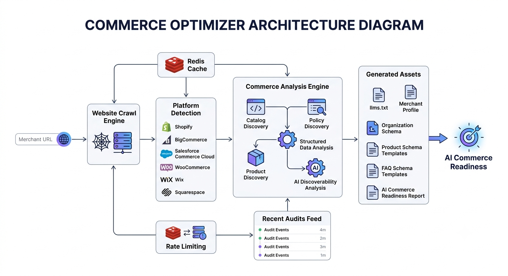
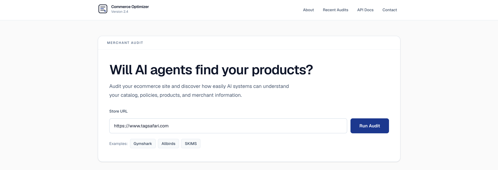
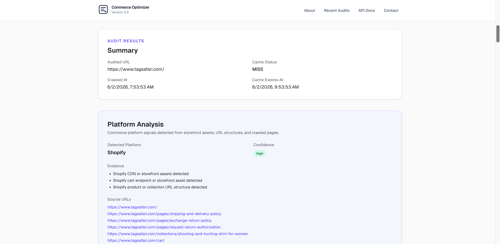
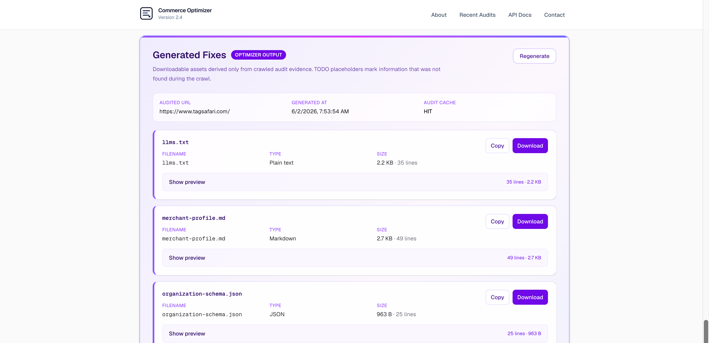
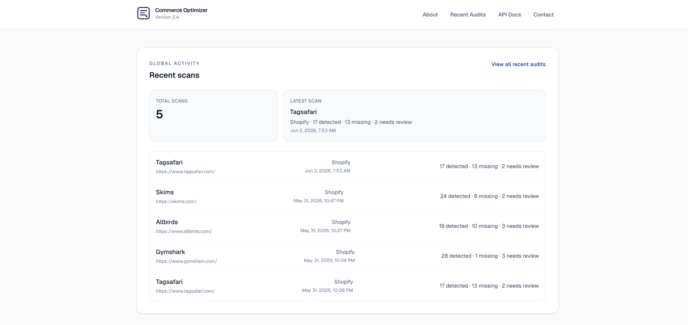

# Commerce Optimizer


Audit ecommerce websites and generate AI-ready commerce assets such as:

* llms.txt
* Merchant profiles
* Organization schema
* Product schema templates
* FAQ schema templates
* AI Commerce Readiness reports

---

## Architecture



Commerce Optimizer crawls merchant websites, analyzes AI discoverability signals, identifies ecommerce platform characteristics, and generates machine-readable assets that help improve AI commerce readiness.

---

## The Challenge

AI-powered commerce experiences are becoming increasingly common.

Consumers are beginning to discover products through ChatGPT, Claude, Perplexity, Gemini, and emerging shopping agents rather than traditional search engines.

Many merchant websites already contain the information AI systems need, but that information is often difficult to discover, poorly structured, or missing entirely.

As a result, AI systems may struggle to:

- Discover products
- Understand merchant policies
- Identify catalog structure
- Locate support information
- Interpret merchant metadata

Commerce Optimizer helps merchants understand:

- Can AI systems discover my products?
- Can AI systems understand my business?
- Are my policies easy to find?
- Is my catalog machine-readable?
- What structured assets are missing?

This project focuses on AI Commerce Discoverability rather than traditional search engine optimization or SEO.

The goal is improving AI Commerce Discoverability.

---

## Why I Built This

I work in payments and commerce infrastructure and have been exploring how AI agents may interact with merchants, catalogs, APIs, and commerce systems.

While there is growing discussion around AI-powered shopping and agentic commerce, there are relatively few practical tools that help merchants understand how discoverable and understandable their websites are to AI systems today.

I built Commerce Optimizer as a personal project to explore this space and to provide a practical way to audit merchant websites, identify discoverability gaps, and generate machine-readable assets from real storefront data.

This project is intended for educational and experimentation purposes and is not affiliated with, endorsed by, or supported by any employer, company, or organization.

---

## Product Walkthrough

### 1. Audit a Store

Enter any ecommerce website and analyze how easily AI systems can discover and understand merchant content.



---

### 2. Analyze Platform & Commerce Signals

Identify platform fingerprints, catalog structure, policies, and machine-readable commerce signals.



---

### 3. Generate AI-Ready Assets

Generate downloadable assets including llms.txt, merchant profiles, schema templates, and AI commerce readiness reports.



---

### 4. Explore Recent Audits

Review recently analyzed merchants and monitor platform activity.



---

## Live Demo

https://agent-commerce-optimizer.vercel.app

---

## Features

### Ecommerce Audit

Analyze merchant websites for:

* Product discovery
* Catalog discovery
* Product pricing
* Product availability
* FAQ pages
* Shipping policies
* Return policies
* Contact information
* Structured data
* AI-readable assets

### Platform Detection

Detect major commerce platforms including:

* Shopify
* BigCommerce
* Salesforce Commerce Cloud
* WooCommerce
* Wix
* Squarespace
* Magento
* CommerceTools

### Generated Assets

Generate:

* llms.txt
* merchant-profile.md
* organization-schema.json
* product-schema-template.json
* faq-schema-template.json
* agent-commerce-readiness.md

---

## Local Development

### Prerequisites

* Node.js 20+
* npm

### Install

```bash
git clone https://github.com/pvemulapalli/agent-commerce-optimizer.git

cd agent-commerce-optimizer

npm install
```

### Run

```bash
npm run dev
```

Open:

```text
http://localhost:3000
```

---

## Environment Variables

Create:

```bash
.env.local
```

Example:

```bash
AUDIT_CACHE_TTL_MINUTES=120

UPSTASH_REDIS_REST_URL=
UPSTASH_REDIS_REST_TOKEN=

SCAN_RATE_LIMIT_PER_HOUR=10

BANNED_SCAN_DOMAINS=amazon.com,walmart.com,target.com,homedepot.com,etsy.com

ADMIN_RESET_TOKEN=

ENABLE_TURNSTILE=false

NEXT_PUBLIC_TURNSTILE_SITE_KEY=
TURNSTILE_SECRET_KEY=
```

---

## Upstash Redis Setup

Create a free Redis database:

1. Sign in at https://upstash.com
2. Create a Redis database
3. Copy:

```bash
UPSTASH_REDIS_REST_URL
UPSTASH_REDIS_REST_TOKEN
```

4. Add to .env.local

Redis is used for:

* Global scan counter
* Recent scans
* Rate limiting
* Shared activity feed

---

## Cloudflare Turnstile Setup

Turnstile is optional.

1. Create a Turnstile widget in Cloudflare.
2. Copy:

```bash
NEXT_PUBLIC_TURNSTILE_SITE_KEY
TURNSTILE_SECRET_KEY
```

3. Set:

```bash
ENABLE_TURNSTILE=true
```

Turnstile helps prevent automated abuse while keeping the experience frictionless for legitimate users.

---

## Local/Admin Maintenance

### Clear Redis data

Commerce Optimizer stores scan activity, audit cache, and rate-limit state in Upstash Redis under the `aco:` prefix.

To reset Redis data locally or in a deployed environment, set a strong server-only token:

```bash
ADMIN_RESET_TOKEN=your-secret-token
```

Then call the admin endpoint (not linked from the public UI):

```bash
curl -X POST http://localhost:3000/api/admin/reset \
  -H "Content-Type: application/json" \
  -d '{"token":"your-secret-token"}'
```

Response:

```json
{
  "status": "ok",
  "deletedKeys": 42
}
```

Or use the npm script (loads `.env.local` when present):

```bash
npm run admin:reset
```

If `ADMIN_RESET_TOKEN` is set, the script calls the admin API. Otherwise it deletes `aco:` keys directly when Upstash Redis env vars are configured.

---

## API

### Audit Website

POST

```text
/api/audit
```

Request:

```json
{
  "url": "https://www.gymshark.com"
}
```

### Generate Assets

POST

```text
/api/generate-fixes
```

Request:

```json
{
  "url": "https://www.gymshark.com"
}
```

---

## Roadmap

* Improved ecommerce discovery
* Merchant recommendations
* OpenAPI specification
* x402 compatibility
* Merchant endpoint integration
* Evaluate publishing audit capabilities as x402 / Visa CLI compatible endpoints

---

## Disclaimer

This is a personal educational project created by Praveen Vemulapalli.

This project is not affiliated with, endorsed by, supported by, or representative of any employer, company, organization, or payment network.

Any opinions, code, demonstrations, examples, or workflows are personal and provided for educational purposes only.

---

## Contact

Praveen Vemulapalli

LinkedIn:
https://www.linkedin.com/in/praveenvemulapalli/

X:
https://x.com/PraveenVem

GitHub:
https://github.com/pvemulapalli

---

## License

Apache License 2.0
